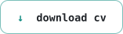

<!--
  Alejandro Alvaro Untiveros · GitHub profile
  Self-contained SVG cards (embedded fonts, CSS animations, no JS) in four variants:
    assets/            desktop · dark      assets/light/      desktop · light
    assets/m/          mobile  · dark      assets/light/m/    mobile  · light
  Each <picture> picks the right one from screen width + light/dark theme.
-->

<picture>
  <source media="(max-width: 640px) and (prefers-color-scheme: dark)" srcset="assets/m/hero.svg" />
  <source media="(max-width: 640px)" srcset="assets/light/m/hero.svg" />
  <source media="(prefers-color-scheme: dark)" srcset="assets/hero.svg" />
  
</picture>

 

<a href="https://github.com/AUntiveros/AUntiveros/blob/main/CV_Alejandro_Alvaro_Untiveros_EN.pdf"><picture>  <source media="(prefers-color-scheme: dark)" srcset="assets/btn-cv.svg" />  </picture></a>&nbsp;&nbsp;
<a href="https://linkedin.com/in/alejandro-alvaro-untiveros-parra-8a59b42a8"><picture>  <source media="(prefers-color-scheme: dark)" srcset="assets/btn-linkedin.svg" />  </picture></a>&nbsp;&nbsp;
<a href="mailto:alvarountiveros2005@gmail.com"><picture>  <source media="(prefers-color-scheme: dark)" srcset="assets/btn-email.svg" />  </picture></a>

  

<picture>
  <source media="(max-width: 640px) and (prefers-color-scheme: dark)" srcset="assets/m/about.svg" />
  <source media="(max-width: 640px)" srcset="assets/light/m/about.svg" />
  <source media="(prefers-color-scheme: dark)" srcset="assets/about.svg" />
  
</picture>

<picture>
  <source media="(max-width: 640px) and (prefers-color-scheme: dark)" srcset="assets/m/experience.svg" />
  <source media="(max-width: 640px)" srcset="assets/light/m/experience.svg" />
  <source media="(prefers-color-scheme: dark)" srcset="assets/experience.svg" />
  
</picture>

<picture>
  <source media="(max-width: 640px) and (prefers-color-scheme: dark)" srcset="assets/m/projects-featured.svg" />
  <source media="(max-width: 640px)" srcset="assets/light/m/projects-featured.svg" />
  <source media="(prefers-color-scheme: dark)" srcset="assets/projects-featured.svg" />
  
</picture>

<picture>
  <source media="(max-width: 640px) and (prefers-color-scheme: dark)" srcset="assets/m/projects-more.svg" />
  <source media="(max-width: 640px)" srcset="assets/light/m/projects-more.svg" />
  <source media="(prefers-color-scheme: dark)" srcset="assets/projects-more.svg" />
  
</picture>

<picture>
  <source media="(max-width: 640px) and (prefers-color-scheme: dark)" srcset="assets/m/awards.svg" />
  <source media="(max-width: 640px)" srcset="assets/light/m/awards.svg" />
  <source media="(prefers-color-scheme: dark)" srcset="assets/awards.svg" />
  
</picture>

<picture>
  <source media="(max-width: 640px) and (prefers-color-scheme: dark)" srcset="assets/m/stack.svg" />
  <source media="(max-width: 640px)" srcset="assets/light/m/stack.svg" />
  <source media="(prefers-color-scheme: dark)" srcset="assets/stack.svg" />
  
</picture>

<picture>
  <source media="(max-width: 640px) and (prefers-color-scheme: dark)" srcset="assets/m/education.svg" />
  <source media="(max-width: 640px)" srcset="assets/light/m/education.svg" />
  <source media="(prefers-color-scheme: dark)" srcset="assets/education.svg" />
  
</picture>

<picture>
  <source media="(max-width: 640px) and (prefers-color-scheme: dark)" srcset="assets/m/footer.svg" />
  <source media="(max-width: 640px)" srcset="assets/light/m/footer.svg" />
  <source media="(prefers-color-scheme: dark)" srcset="assets/footer.svg" />
  
</picture>

