<!--
  Alejandro Alvaro Untiveros · GitHub profile
  Each section is a self-contained SVG card (fonts embedded, CSS animations, no JS).
  Desktop cards live in /assets, single-column mobile cards in /assets/m;
  <picture> swaps them automatically on narrow screens.
-->

<picture>
  <source media="(max-width: 640px)" srcset="assets/m/hero.svg" />
  
</picture>

 

&nbsp;&nbsp;
&nbsp;&nbsp;

  

<picture>
  <source media="(max-width: 640px)" srcset="assets/m/about.svg" />
  
</picture>

<picture>
  <source media="(max-width: 640px)" srcset="assets/m/experience.svg" />
  
</picture>

<picture>
  <source media="(max-width: 640px)" srcset="assets/m/projects-featured.svg" />
  
</picture>

<picture>
  <source media="(max-width: 640px)" srcset="assets/m/projects-more.svg" />
  
</picture>

<picture>
  <source media="(max-width: 640px)" srcset="assets/m/awards.svg" />
  
</picture>

<picture>
  <source media="(max-width: 640px)" srcset="assets/m/stack.svg" />
  
</picture>

<picture>
  <source media="(max-width: 640px)" srcset="assets/m/education.svg" />
  
</picture>

<picture>
  <source media="(max-width: 640px)" srcset="assets/m/footer.svg" />
  
</picture>

